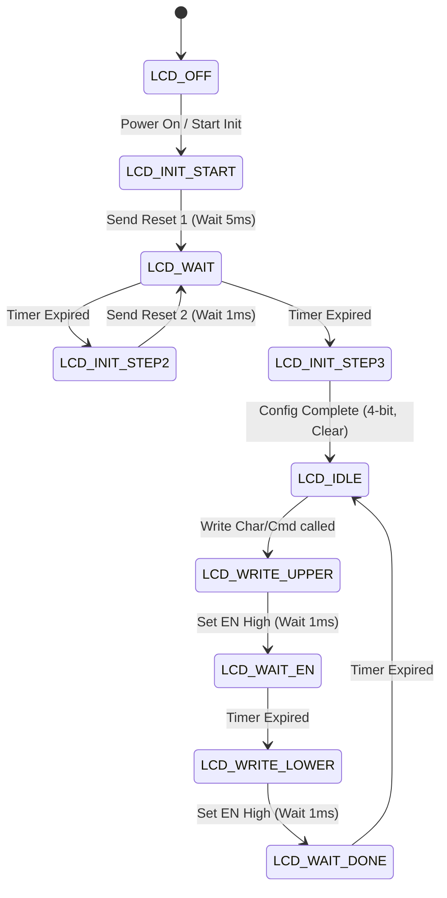

# TP3 – Actividad 01 – LCD Display Driver (porting C code) 

## (Paso 07)
> **Consulta:** ¿Puedes ayudarme a realizar un Trabajo Práctico sobre LCD Display (porting C
> code) - System Setup (statechart - modeling - c coding)?

---

## 1. Introducción
El objetivo de este trabajo práctico es desarrollar un controlador de display LCD robusto, portátil y no bloqueante. Para lograrlo, el diseño se divide en tres pilares fundamentales:
1.  **System Setup & Porting (Capa de Abstracción de Hardware - HAL):** Para separar la lógica de control del hardware específico.
2.  **Modelado (Statechart):** Para definir el comportamiento temporal y secuencial sin detener la ejecución del microcontrolador (Non-blocking).
3.  **Implementación en C:** La codificación de la Máquina de Estados Finitos (FSM).

---

## 2. System Setup y Capa de Portabilidad (Porting)
Para garantizar que el código pueda ser utilizado en cualquier microcontrolador (STM32, ESP32, AVR, etc.), se define una capa de abstracción. El archivo `lcd_port.h` debe definir las dependencias del hardware.

### Estructura de Portabilidad (`lcd_port.h`)
El usuario del driver solo debe completar estas macros o funciones de enlace según su plataforma:

```c
#ifndef LCD_PORT_H
#define LCD_PORT_H

#include <stdint.h>
#include <stdbool.h>

/* ================================================================= */
/* CONFIGURACIÓN ESPECÍFICA DEL HARDWARE (A completar por el usuario)*/
/* ================================================================= */

// Función para obtener los milisegundos actuales del sistema (ej. HAL_GetTick() en STM32)
uint32_t LCD_PORT_GetTick(void);

// Estados lógicos
#define LCD_PIN_HIGH 1
#define LCD_PIN_LOW  0

// Control de pines de control
void LCD_PORT_SetRS(uint8_t state);
void LCD_PORT_SetEN(uint8_t state);

// Control del bus de datos (Ejemplo para modo 4-bits)
void LCD_PORT_WriteNibble(uint8_t nibble);

#endif // LCD_PORT_H
```

---

## 3. Modelado del Comportamiento (Statechart)
La inicialización y escritura del LCD dependen fuertemente de tiempos de espera (retardos de milisegundos y microsegundos). Un enfoque bloqueante usando simples `delay()` desperdicia ciclos de CPU. 

Para solucionarlo, modelamos el controlador mediante una Máquina de Estados Finitos (FSM).

### Diagrama de Estados (Mermaid)
*(Si visualizas este archivo en GitHub, Obsidian, Notion o un editor compatible con Mermaid, verás el diagrama generado automáticamente)*.



---

## 4. Implementación en C (Máquina de Estados)
A continuación, se presenta la implementación del motor de la FSM en el archivo `lcd_core.c`. Esta función debe ser llamada constantemente en el bucle principal (`main loop`).

```c
#include "lcd_port.h"

// Definición de los estados del LCD
typedef enum {
    STATE_LCD_OFF,
    STATE_LCD_INIT_START,
    STATE_LCD_WAIT,
    STATE_LCD_INIT_STEP2,
    STATE_LCD_INIT_STEP3,
    STATE_LCD_IDLE,
    STATE_LCD_WRITE_UPPER,
    STATE_LCD_WRITE_LOWER
} LCD_State_t;

// Estructura de contexto del LCD
typedef struct {
    LCD_State_t current_state;
    LCD_State_t next_state;    // Estado al que irá después del WAIT
    uint32_t timer_start;
    uint32_t delay_ms;
    
    uint8_t data_to_send;
    uint8_t is_command;
} LCD_Handle_t;

// Instancia global o pasada por referencia
LCD_Handle_t hlcd;

// Inicialización de la estructura
void LCD_Init(void) {
    hlcd.current_state = STATE_LCD_INIT_START;
}

// Lógica principal (Llamar en el while(1))
void LCD_Process(void) {
    uint32_t current_tick = LCD_PORT_GetTick();

    switch (hlcd.current_state) {
        case STATE_LCD_OFF:
            // No hace nada hasta que se llame a LCD_Init()
            break;

        case STATE_LCD_INIT_START:
            // Secuencia de inicialización (Comando 1)
            LCD_PORT_SetRS(LCD_PIN_LOW);
            LCD_PORT_WriteNibble(0x03); 
            
            // Configurar delay no bloqueante
            hlcd.timer_start = current_tick;
            hlcd.delay_ms = 5; 
            hlcd.next_state = STATE_LCD_INIT_STEP2;
            hlcd.current_state = STATE_LCD_WAIT;
            break;

        case STATE_LCD_INIT_STEP2:
            // Secuencia de inicialización (Comando 2)
            LCD_PORT_WriteNibble(0x03);
            
            hlcd.timer_start = current_tick;
            hlcd.delay_ms = 1; 
            hlcd.next_state = STATE_LCD_INIT_STEP3;
            hlcd.current_state = STATE_LCD_WAIT;
            break;

        case STATE_LCD_INIT_STEP3:
            // Pasar a 4 bits y limpiar pantalla
            LCD_PORT_WriteNibble(0x02);
            hlcd.current_state = STATE_LCD_IDLE;
            break;

        case STATE_LCD_WAIT:
            // Estado de espera no bloqueante
            if ((current_tick - hlcd.timer_start) >= hlcd.delay_ms) {
                hlcd.current_state = hlcd.next_state;
            }
            break;

        case STATE_LCD_IDLE:
            // Esperando nuevos datos para enviar
            // (La lógica para encolar caracteres iría aquí)
            break;

        case STATE_LCD_WRITE_UPPER:
            // Envío del nibble superior (implementación simplificada)
            // ...
            break;
            
        // Otros estados (WRITE_LOWER, etc.) omitidos por brevedad...
    }
}
```

## 5. Conclusión
El uso de una capa HAL (`lcd_port.h`) asegura que este código puede migrar de plataforma simplemente reescribiendo unas cuantas macros o funciones puente. A su vez, la adopción del modelo Statechart garantiza que el procesador quede libre para atender otras tareas, maximizando la eficiencia del sistema en tiempo real.


---

## (Paso 08)
> **Consulta:** Analizar  y  explicar  (en español), el funcionamiento  del código fuente contenido en los archivos adjuntos: 
> app.c  ,  app_it.c  ,  systick.c  ,  task_test_attribute.h  ,  task_test.c  ,  task_display_attribute.h  , 
> task_display_interface.c  ,  task_display.c  ,  display.h  y  display.c  . 
> Indicar  el comportamiento de las funciones  void  task_test_statechart  (  void  )  y  void  
> task_display_statechart  (  void  ). 

# Análisis del Código Fuente: Sistema Bare Metal y Control LCD

El sistema presentado implementa una arquitectura "Bare Metal" orientada a eventos (Event-Triggered System) para gestionar rutinas de forma no bloqueante utilizando un planificador de tareas y una máquina de estados finitos.

A continuación, se detalla el funcionamiento lógico agrupado por módulos:

## 1. Módulo de Aplicación y Planificador (`app.c`, `app_it.c`)
*   El archivo `app.c` contiene el bucle principal que inicializa (`app_init`) y actualiza (`app_update`) de forma periódica las tareas del sistema basándose en marcas de tiempo. Registra métricas de ejecución (tiempo de ejecución en el mejor y peor caso, conteos) para cada tarea registrada en la lista `task_cfg_list`. 
*   El archivo `app_it.c` gestiona las interrupciones del hardware, incrementando el contador global `g_app_tick_cnt` en cada interrupción del SysTick.

## 2. Módulo Driver del Display (`display.c`, `display.h`, `systick.c`)
*   Componen la capa de abstracción de hardware (HAL) para inicializar y comandar un controlador de pantalla LCD compatible (tipo HD44780). 
*   `display.c` contiene rutinas para enviar instrucciones y datos a través de los pines GPIO en modos de 4 o 8 bits, limpiar la pantalla, configurar el cursor y escribir cadenas enteras. 
*   `systick.c` aporta una función de retardo bloqueante a nivel de microsegundos (`systick_delay_us`) mediante la lectura directa del registro de cuenta del SysTick de la arquitectura ARM. Esto es necesario para cumplir con los estrictos tiempos del hardware del LCD durante la inicialización y envío de comandos de bajo nivel.

## 3. Módulo Tarea de Display (`task_display.c`, `task_display_attribute.h`, `task_display_interface.c`)
*   Maneja la actualización de la pantalla de forma estructurada. 
*   `task_display_attribute.h` define la memoria de video virtual (`ddram`) como una matriz bidimensional (filas y columnas) y los estados del sistema. 
*   `task_display_interface.c` expone la función `put_event_task_display()`. Esta función actúa como un puente de comunicación para que cualquier otra tarea pueda almacenar un mensaje de texto en la memoria `ddram` en una fila y columna específica, y a su vez levantar la bandera (flag) del evento `EV_DSP_UPDATE` para notificar que hay nueva información lista para ser mostrada.

## 4. Módulo Tarea de Prueba (`task_test.c`, `task_test_attribute.h`)
*   Constituye la tarea de aplicación cliente. Su inicialización imprime mensajes fijos de bienvenida en el display ("LCD Display Test", " Porting C code ") mediante la interfaz del display.

---

## Análisis de Máquinas de Estados (Statecharts)

### Comportamiento de `void task_test_statechart(void)`
Esta función controla el avance de un evento cíclico temporizado para generar mensajes de prueba constantes en la pantalla.

*   Incrementa un contador interno `counter` en cada ejecución de la tarea.
*   Decrementa de forma continua la variable de tiempo `tick`, la cual inicia en el valor de retardo máximo configurado (`DEL_TEST_XX_MAX = 1000`).
*   Cuando `tick` llega a 0, la tarea restablece el valor del temporizador nuevamente al máximo.
*   Inmediatamente después del restablecimiento del temporizador, invoca la interfaz del display (`put_event_task_display`) para mandar una cabecera de texto ("Test Nro: ******") y luego formatea el valor numérico de los ciclos totales divididos por el límite (`counter / DEL_TEST_XX_MAX`). Finalmente, envía este string dinámico al display para ser mostrado en la fila inferior.

### Comportamiento de `void task_display_statechart(void)`
Esta función implementa la máquina de estados de la tarea encargada de actualizar físicamente el hardware del LCD basándose en el contenido de su memoria virtual bidimensional.

*   Evalúa constantemente la variable de estado `p_task_display_dta->state`.
*   **Estado `ST_DSP_IDLE`:** Es el estado de reposo. Comprueba constantemente si otra tarea modificó el estado de las banderas a través de la interfaz. Si la variable `flag` es verdadera y el evento registrado es igual a `EV_DSP_UPDATE`, realiza una transición al estado `ST_DSP_UPDATE`.
*   **Estado `ST_DSP_UPDATE`:** 
    1. Primero, reconfirma la condición del evento y apaga la bandera (`flag = false`) para indicar que está procesando la solicitud. 
    2. Acto seguido, reinicia las variables de apuntador a cero (`row = 0`, `column = 0`).
    3. Invoca las funciones del driver directamente usando `displayCharPositionWrite(0, 0)` para ubicar el cursor físico en el inicio y vuelca la fila 0 del buffer `ddram` utilizando `displayStringWrite`. 
    4. Inmediatamente repite este proceso colocando el cursor físico en `(0, 1)` para volcar la fila 1 de la memoria `ddram`.
    5. Al culminar las impresiones de las dos líneas, la máquina de estados devuelve su valor a `ST_DSP_IDLE` para quedar a la espera de nuevos paquetes de datos.


---

## Depuración del modelo y Rendimiento de Tareas (Paso 10)

> **Consulta:** 
> Luego de varias ejecuciones de  app_update()  ,  leer  y  almacenar  los valores de  task_dta_list [index]  (  indicar  unidad de 
> medida) en  : …\ tdse_workspace \ tdse-tp3_02-porting_c_code \ tdse-tp3_01-display.md  .  Analizar  si cumplen con las 
> restricciones temporales del  ejecutor cíclico  .


# Mediciones de Tareas y Análisis de Restricciones Temporales

Luego de varias ejecuciones de la función `app_update()`, se extrajeron los siguientes valores de rendimiento de las tareas del sistema desde el depurador:

## Tabla de Valores `task_dta_list[index]`

**Unidad de medida temporal:** Microsegundos ($\mu s$). Según la estructura `task_dta_t` definida en `app.c`, los tiempos (LET, BCET, WCET) se miden en microsegundos.

| Índice | Tarea Asignada | NOE (Ejecuciones) | LET ($\mu s$) | BCET ($\mu s$) | WCET ($\mu s$) |
| :---: | :--- | :--- | :--- | :--- | :--- |
| `0` | `task_test` | 13552 | 2 | 2 | **36** |
| `1` | `task_display` | 13552 | 2 | 2 | **6206** |

*Referencias:*
- **NOE:** Number of execution (Número de ejecuciones)
- **LET:** Last execution time (Último tiempo de ejecución)
- **BCET:** Best-case execution time (Tiempo de ejecución en el mejor caso)
- **WCET:** Worst-case execution time (Tiempo de ejecución en el peor caso)

---

## Análisis de Restricciones Temporales (Ejecutor Cíclico)

Para que un sistema basado en un ejecutor cíclico temporizado funcione correctamente y garantice el determinismo en tiempo real, el tiempo de ejecución en el peor caso (WCET) de la suma de todas las tareas ejecutadas en un ciclo **debe ser estrictamente menor al período del sistema (Tick)**.

Según la configuración de la aplicación (`p_app__ = "(Update by Time Code, period = 1mS)"`), el sistema tiene un período de **$1\text{ ms}$ (o $1000\ \mu s$)**.

### Evaluación:
- El WCET de la tarea de prueba (`task_test`) es de $36\ \mu s$, lo cual es muy inferior a $1000\ \mu s$. Cumple la restricción de forma aislada.
- **El WCET de la tarea de display (`task_display`) es de $6206\ \mu s$ (aproximadamente $6.2\text{ ms}$).**

### Conclusión:
**NO se cumplen las restricciones temporales del ejecutor cíclico.** 

El tiempo máximo que tarda en ejecutarse la tarea del display ($6206\ \mu s$) supera ampliamente el límite impuesto por el período del sistema ($1000\ \mu s$). Esto indica que cuando la máquina de estados del display entra en su estado de actualización (`ST_DSP_UPDATE`), las rutinas de comunicación del LCD (probablemente debido a retardos bloqueantes internos en la función `displayCharPositionWrite` o `displayStringWrite`) monopolizan la CPU durante más de 6 milisegundos.

Como consecuencia, el sistema pierde la capacidad de atender eventos a tiempo, pierde "ticks" del reloj principal y rompe el comportamiento no-bloqueante esperado para esta arquitectura. Para solucionarlo, las rutinas del driver del display deben rediseñarse para ser verdaderamente no bloqueantes utilizando el Systick timer.